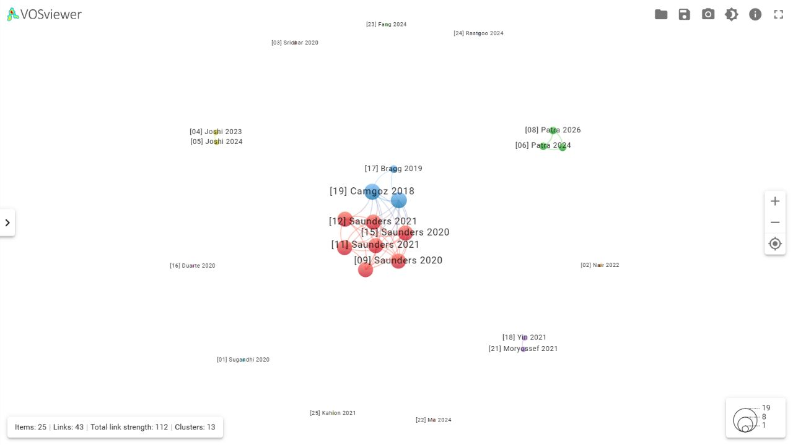
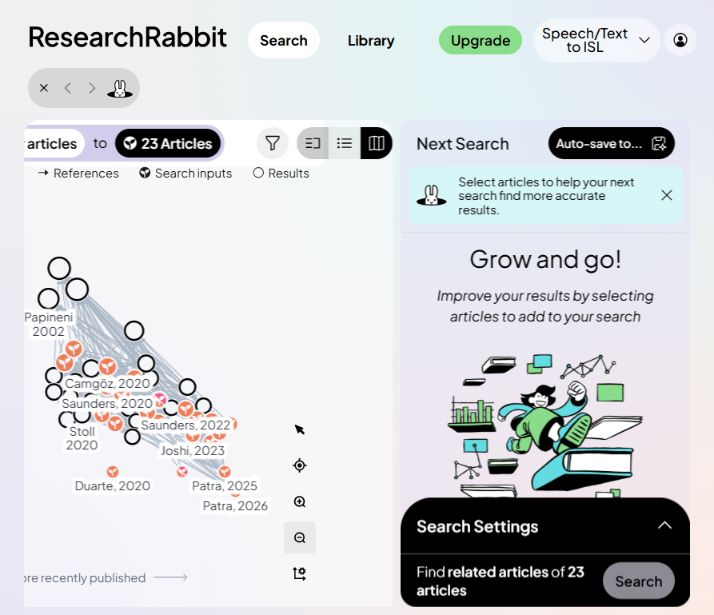

RESEARCH METHODOLOGY

Assignment 2Speech and Text toIndian Sign Language

Name: Aadya Arun Talreja &nbsp;&nbsp; USN: 1RVU23CSE003

Literature mapping and research-network analysis | 3 November 2026

1. Aim and scope

To examine the literature and collaboration structure relevant to SignAI, our experimental English speech/text-to-Indian Sign Language (ISL) playback project. The corpus connects ISL grammar and gloss conversion, data resources, continuous sign production, non-manual features, and human evaluation. Eight papers directly concern ISL [1-8]; the remaining seventeen provide comparative methods and research context [9-25].

2. Project context

The current prototype accepts English text or browser speech transcription, constructs a gloss sequence, resolves signs from a repository, and plays available signer videos or avatar clips. Its draft grammar, demonstration assets, and spelling fallbacks require ISL signer review. This assignment maps research that can guide development; it does not establish the linguistic accuracy of the prototype.

3. Corpus selection and verification

A purposive corpus of 25 distinct research works was assembled from arXiv, ACL Anthology, CVF, and publisher/Crossref records. Titles, complete author lists, dates, and persistent links were checked on 3 November 2026. Inclusion required direct relevance to ISL or a clear connection to translation, pose generation, co-articulation, resources, or evaluation. Generic machine-translation papers and alphabet-only recognition demonstrations were excluded.

References use the year of the cited record: initial arXiv submission for arXiv records and publication metadata for DOI records. A conference version may have a later year. For example, SignLLM is cited as a 2024 preprint here, while ResearchRabbit indexes a 2025 workshop version. The set includes conference papers, journal articles, reviews, and preprint records; it is not described as 25 journal articles. It is a focused sample, not a systematic or exhaustive review.

---

4. VOSviewer bibliographic network

Figure 1. Genuine VOSviewer Online screenshot of the full 25-paper shared-authorship network. The application reports 25 items, 43 links, total link strength 112, and 13 clusters. Numeric labels refer to the bibliography. Some labels overlap within the tightly connected production group.

Network definition. Each node is a paper. An undirected edge exists when two papers share at least one author; edge strength is the number of shared authors. Full names are normalized for case and diacritics; surnames alone are never matched. The edge list is derived from the verified corpus and imported as VOSviewer JSON without preset coordinates or clusters. These are collaboration-proximity links, not citations, co-citations, or bibliographic coupling.

Settings. Association-strength normalization; attraction 2; repulsion -1 for readable separation; clustering resolution 1; minimum cluster size 1; merging of small clusters enabled. All papers, including isolates, are retained. Node size uses the number of links. VOSviewer computed the layout and clusters. No citation counts were supplied.

Measure | Calculation / result

Binary density | D = 2E / [N(N - 1)] = 86 / 600 = 0.1433 = 14.33%

Mean degree | 2E / N = 86 / 25 = 3.44

Weighted edge total | 112 shared-author units across 43 edges

Highest paper degree | [19] and [20]: 9 neighbours each; weighted strength 19 each

The density calculation counts each edge once, irrespective of how many authors are shared. Weighted strength is a separate quantity. Thirteen clusters include single-paper groups; clusters must not be interpreted automatically as thirteen research themes.

---

5. ResearchRabbit paper-connection graph

Figure 2. Genuine ResearchRabbit graph from the assignment collection and a Similar articles search. Search inputs and retrieved results are distinguished by the application legend; directed reference arrows describe ResearchRabbit relationships.

Workflow. The 25-record BibTeX file was submitted for import. Automatically resolved records were checked against the saved collection. Two unrelated saved-record substitutions were removed from the assignment collection; How2Sign and the existing ISL gloss-conversion and systematic-review records were added individually. The final collection contains 23 verified corpus works. Papers [13] and [15] were not among the 23 saved search inputs. Paper [15] subsequently appears among the related search results. Both remain in the full 25-paper bibliography and VOSviewer network.

Coverage and interpretation. A Similar articles search was run from this 23-paper collection, requesting 20 results. The displayed map contains input records and retrieved neighbours, so its node count is not the size of the verified corpus. ResearchRabbit can index conference and preprint versions separately and can display publication years that differ from the cited arXiv records. No citation-density or global influence ranking is inferred from the picture.

Reading the map. The graph provides a reading route between ISL-specific work, sign-generation research, and related translation resources. It complements Figure 1 because reference relationships can connect papers written by entirely different teams. The VOSviewer density and author counts are calculated only from the reproducible 25-paper shared-authorship data, not from this expanded graph.

---

6. Influential contribution and connected authors

Selected foundational production paper: Saunders, Camgoz, and Bowden (2020), Progressive Transformers for End-to-End Sign Language Production [9]. Its text-to-continuous-pose formulation, variable-length generation, and back-translation evaluation make it a useful methodological foundation for the project. This is a reasoned selection based on task relevance; it is not a claim that the paper has the highest citation count.

Most connected papers: Neural Sign Language Translation [19] and Sign Language Transformers [20] each connect to nine corpus papers. Seven Saunders-led production works [9-15] each connect to eight papers and have weighted strength 22. These values measure shared-author overlap; they do not rank translation quality or scholarly impact.

Author(s) | Corpus papers | Reference numbers

Necati Cihan Camgoz; Richard Bowden | 9 each | [9-15], [19], [20]

Ben Saunders | 7 | [9-15]

Suvajit Patra; Arkadip Maitra; Soumitra Samanta | 3 each | [6-8]

Oscar Koller | 3 | [17], [19], [20]

Abhinav Joshi; Ashutosh Modi | 2 each | [4], [5]

Kayo Yin; Amit Moryossef; Yoav Goldberg | 2 each | [18], [21]

7. Network analysis (200-300 words)

The 25-paper corpus connects Indian Sign Language resources and grammar-based conversion with continuous sign production, multimodal animation, and evaluation. Eight works directly address ISL, while the other papers supply comparative methods and broader linguistic context. This balance supports the project without treating German or American Sign Language results as evidence of ISL accuracy.

The VOSviewer graph represents papers as nodes and shared authors as weighted links. Its 43 links yield a density of 14.33% and a mean degree of 3.44. The strongest collaborative region contains the Saunders, Camgoz, and Bowden production series. Camgoz and Bowden each occur in nine selected works. Neural Sign Language Translation and Sign Language Transformers each have nine neighbouring papers, whereas the seven Saunders-led production papers each have eight.

A separate ISL collaboration joins Patra, Maitra, and Samanta across recognition resources and continuous production. Joshi and Modi connect ISLTranslate with iSign. Yin, Moryossef, and Goldberg link linguistic inclusion with low-resource gloss translation. These groupings reflect shared research teams rather than automatically extracted topics. VOSviewer reports thirteen clusters, including isolated papers.

ResearchRabbit complements this structure through a reference graph generated from twenty-three resolved corpus works and related search results. It supports literature discovery across teams; its expanded nodes must not be used in the VOSviewer density calculation.

Progressive Transformers is selected as a foundational production contribution because it addresses continuous text-to-pose generation. For our project, the literature motivates reviewed ISL glosses, licensed assets, co-articulation, non-manual expression, and Deaf-signer comprehension testing. Smooth playback and successful software tests alone cannot demonstrate linguistic correctness.

---

8. Implications for our project

Project component | Literature connection and proposed next step

English speech/text to gloss | [1], [2], [18]: review English-to-ISL transformations with ISL signers; preserve meaning and non-manual information. Speech transcription errors should be evaluated separately.

Repository and data | [3-6], [16]: compare vocabulary and continuous-pair resources. Confirm usage terms, signer consent, and attribution before ingesting recordings. Recognition datasets do not automatically provide sentence-level production targets.

Avatar and video playback | [7-15], [22]: study continuous motion, timing, handshape fidelity, transitions, and facial/body channels. Interpolated clips require comprehension review.

Evaluation | [9], [11], [14], [17]: combine held-out examples and diagnostic automatic measures with native ISL signer comprehension and acceptability studies. Back-translation scores depend on the reverse model.

Project evidence | The current repository describes an experimental prototype with demo assets and unverified grammar. Report software checks separately from signer-reviewed linguistic evaluation; do not transfer published model scores to this system.

9. Evidence and reproducibility

Assignment element | Evidence supplied

At least 25 genuine papers | 25 verified bibliographic records with primary/registration links

VOSviewer network screenshot | Actual 25-item application screenshot; 43 reproducible edges

ResearchRabbit graph | Actual graph from 23 resolved corpus works plus related results; two unresolved records explicitly disclosed

Influence and author connections | Conceptual paper selection separated from measured degree and author occurrence

Network analysis | A 200-300 word analysis, with counts calculated from the exported edge list

Supporting files: ISL-25-papers.csv, ISL-25-papers.bib, corpus.json, shared-author-edges.csv, network-statistics.json, ISL-VOSviewer-network.json, and the application screenshots. The input JSON permits VOSviewer to compute a new layout; screenshots preserve the observed session. The editable report text is supplied separately.

Software: VOSviewer Online; VOSviewer JSON specification; ResearchRabbit assignment collection. Bibliography metadata: arXiv, ACL Anthology, CVF, and Crossref DOI registration records. INCLUDE's short Crossref title was expanded using the authors' AI4Bharat publication record.

---

10. References - verified research corpus

Records are numbered consistently across the corpus and VOSviewer labels. Full author lists are retained in the CSV, BibTeX, and JSON files. Preprint-record years are distinguished from later proceedings versions.

[1] Sugandhi, Parteek Kumar, Sanmeet Kaur (2020). Sign Language Generation System Based on Indian Sign Language Grammar. DOI: 10.1145/3384202. https://doi.org/10.1145/3384202

[2] Malu S Nair, Sumam Mary Idicula (2022). English to Indian Sign Language Gloss Conversion Using a Rule-Based Approach. DOI: 10.1007/978-981-19-3951-8_55. https://doi.org/10.1007/978-981-19-3951-8_55

[3] Advaith Sridhar, Rohith Gandhi Ganesan, Pratyush Kumar et al. (2020). INCLUDE: A Large Scale Dataset for Indian Sign Language Recognition. DOI: 10.1145/3394171.3413528. https://doi.org/10.1145/3394171.3413528

[4] Abhinav Joshi, Susmit Agrawal, Ashutosh Modi (2023). ISLTranslate: Dataset for Translating Indian Sign Language. arXiv:2307.05440. https://arxiv.org/abs/2307.05440

[5] Abhinav Joshi, Romit Mohanty, Mounika Kanakanti et al. (2024). iSign: A Benchmark for Indian Sign Language Processing. arXiv:2407.05404. https://arxiv.org/abs/2407.05404

[6] Suvajit Patra, Arkadip Maitra, Megha Tiwari et al. (2024). Hierarchical Windowed Graph Attention Network and a Large Scale Dataset for Isolated Indian Sign Language Recognition. arXiv:2407.14224. https://arxiv.org/abs/2407.14224

[7] Suvajit Patra, Arkadip Maitra, Soumitra Samanta (2025). A Continuous Indian Sign Language Production System from Isolated Signs. DOI: 10.1109/ICSCC66177.2025.11233467. https://doi.org/10.1109/ICSCC66177.2025.11233467

[8] Suvajit Patra, Arkadip Maitra, Swami Punyeshwarananda et al. (2026). A Gloss-driven Indian Sign Language Production System Using Learned Pose Representations. DOI: 10.24963/ijcai.2026/823. https://doi.org/10.24963/ijcai.2026/823

[9] Ben Saunders, Necati Cihan Camgoz, Richard Bowden (2020). Progressive Transformers for End-to-End Sign Language Production. arXiv:2004.14874. https://arxiv.org/abs/2004.14874

[10] Ben Saunders, Necati Cihan Camgoz, Richard Bowden (2020). Adversarial Training for Multi-Channel Sign Language Production. arXiv:2008.12405. https://arxiv.org/abs/2008.12405

[11] Ben Saunders, Necati Cihan Camgoz, Richard Bowden (2021). Continuous 3D Multi-Channel Sign Language Production via Progressive Transformers and Mixture Density Networks. arXiv:2103.06982. https://arxiv.org/abs/2103.06982

[12] Ben Saunders, Necati Cihan Camgoz, Richard Bowden (2021). Mixed SIGNals: Sign Language Production via a Mixture of Motion Primitives. arXiv:2107.11317. https://arxiv.org/abs/2107.11317

[13] Ben Saunders, Necati Cihan Camgoz, Richard Bowden (2021). Skeletal Graph Self-Attention: Embedding a Skeleton Inductive Bias into Sign Language Production. arXiv:2112.05277. https://arxiv.org/abs/2112.05277

[14] Ben Saunders, Necati Cihan Camgoz, Richard Bowden (2022). Signing at Scale: Learning to Co-Articulate Signs for Large-Scale Photo-Realistic Sign Language Production. arXiv:2203.15354. https://arxiv.org/abs/2203.15354

[15] Ben Saunders, Necati Cihan Camgoz, Richard Bowden (2020). Everybody Sign Now: Translating Spoken Language to Photo Realistic Sign Language Video. arXiv:2011.09846. https://arxiv.org/abs/2011.09846

[16] Amanda Duarte, Shruti Palaskar, Lucas Ventura et al. (2020). How2Sign: A Large-scale Multimodal Dataset for Continuous American Sign Language. arXiv:2008.08143. https://arxiv.org/abs/2008.08143

[17] Danielle Bragg, Oscar Koller, Mary Bellard et al. (2019). Sign Language Recognition, Generation, and Translation: An Interdisciplinary Perspective. arXiv:1908.08597. https://arxiv.org/abs/1908.08597

[18] Kayo Yin, Amit Moryossef, Julie Hochgesang et al. (2021). Including Signed Languages in Natural Language Processing. arXiv:2105.05222. https://arxiv.org/abs/2105.05222

[19] Necati Cihan Camgoz, Simon Hadfield, Oscar Koller et al. (2018). Neural Sign Language Translation. Proceedings of the IEEE Conference on Computer Vision and Pattern Recognition. https://openaccess.thecvf.com/content_cvpr_2018/html/Camgoz_Neural_Sign_Language_CVPR_2018_paper.html

[20] Necati Cihan Camgoz, Oscar Koller, Simon Hadfield et al. (2020). Sign Language Transformers: Joint End-to-end Sign Language Recognition and Translation. arXiv:2003.13830. https://arxiv.org/abs/2003.13830

[21] Amit Moryossef, Kayo Yin, Graham Neubig et al. (2021). Data Augmentation for Sign Language Gloss Translation. Proceedings of the 1st International Workshop on Automatic Translation for Signed and Spoken Languages (AT4SSL). https://aclanthology.org/2021.mtsummit-at4ssl.1/

[22] Xiaohan Ma, Rize Jin, Tae-Sun Chung (2024). Multi-Channel Spatio-Temporal Transformer for Sign Language Production. Proceedings of the 2024 Joint International Conference on Computational Linguistics, Language Resources and Evaluation (LREC-COLING 2024). https://aclanthology.org/2024.lrec-main.1022/

[23] Sen Fang, Chen Chen, Lei Wang et al. (2024). SignLLM: Sign Language Production Large Language Models. arXiv:2405.10718. https://arxiv.org/abs/2405.10718

[24] Razieh Rastgoo, Kourosh Kiani, Sergio Escalera et al. (2024). A survey on recent advances in Sign Language Production. DOI: 10.1016/j.eswa.2023.122846. https://doi.org/10.1016/j.eswa.2023.122846

[25] Navroz Kaur Kahlon, Williamjeet Singh (2021). Machine translation from text to sign language: a systematic review. DOI: 10.1007/s10209-021-00823-1. https://doi.org/10.1007/s10209-021-00823-1